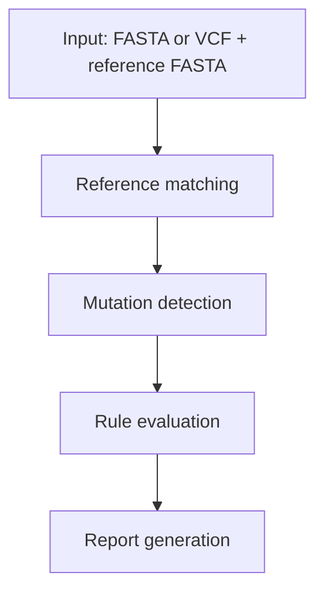

# How It Works

ResistanceProfiler compares a new sample against a curated project database and reports the resistance mutations it finds. This page explains what happens behind the scenes, from input file to final report.

The core idea: ResPro stores curated rules against internal project references, then maps new FASTA- or VCF-based inputs back into that internal reference space before comparing amino-acid mutations against the rules.

!!! tip "Think of it as a normalisation framework"
    Different sample reference spaces go in, one internal project reference space comes out for rule matching.

## Pipeline overview

### Build and use one consistent project database

The project database stores internal references, CDS annotations, and curated resistance rules. All later profiling steps are anchored to this database. References and rules are matched during database creation to ensure internal consistency.

### Input parsing

- **VCF mode** uses a variant file plus a reference FASTA.
- **FASTA mode** uses a consensus sequence directly.

In both modes, input is converted into a common internal representation before rule matching.

#### FASTA-mode specifics

- **IUPAC ambiguity codes** in the consensus sequence are expanded into all possible alternative bases. Each mutation ALT receives a fractional allele frequency of `1 / len(options)`, where `options` is the full IUPAC base set (the reference base is one of the equally-likely possibilities = no mutation, so it is included in the denominator but not emitted as an ALT). For example, `ref=A, query=R` (R={A,G}) → `G=0.5`; `ref=A, query=Y` (Y={C,T}) → `C=0.5, T=0.5`; `ref=A, query=N` (N={A,C,G,T}) → `C=0.25, G=0.25, T=0.25`.
- **N-stretch coverage gaps** — full-NNN codons are treated as non-covered positions and reported as coverage gaps rather than variants. Partial-N codons (1–2 N bases) remain assessable and emit expanded IUPAC variants for the non-N positions.
- **FASTA-mode AF bins** use adjusted thresholds for the discrete IUPAC-derived frequencies: **high** (0.75–1.0), **intermediate** (0.35–0.74), **low** (0.01–0.34).
- **VCF-mode AF bins** use: **high** (0.75–1.0), **intermediate** (0.25–0.7499), **low** (0.01–0.2499).
- **VCF-mode AF source** — for VCF input, per-allele allele frequency is resolved from a fixed INFO-then-FORMAT precedence (`INFO/AF` → `INFO/VAF` → `INFO/FREQ` → `FORMAT/AF` → `FORMAT/AD`-derived), reading only the first sample for FORMAT-level values. Missing entries and short allele-specific arrays use a **residual** fallback (`max(0, 1 - sum(known))` split equally among missing alleles) rather than assuming a missing allele is fully present. See [CLI Reference — Allele-frequency source](cli-reference.md#allele-frequency-source-vcf-mode) for the full contract.
- **Insertions and deletions** in FASTA mode are detected from alignment gaps (CIGAR-based) between the aligned query and the reference CDS.

### Reference matching and coordinate mapping

Query sequence context is aligned to the internal project references and features. Only rule-backed features (`has_rules = 1`, i.e. features carrying at least one resistance rule) participate in alignment; a FASTA record that aligns to no rule-backed feature is dropped with a warning rather than profiled. The reference is determined automatically from [minimap2](https://github.com/lh3/minimap2)-based (mappy) CDS matching, and the sequence with the highest identity is selected.

#### VCF reference comparison

VCF variants are called against the **supplied** reference FASTA, but resistance rules are defined against the **internal project reference** — the two often differ. ResPro compares both and emits one variant set in internal-reference coordinates:

- The supplied↔internal alignment (the same minimap2 CIGAR used for coordinate mapping) yields **baseline differences**: positions where the supplied reference differs from the internal reference. Baseline variants carry an assumed allele frequency of 1.0 — an assumption derived from the reference comparison, not a measured allele fraction — and are labelled `Reference derived` in the report.
- Each in-cutoff VCF call is applied as a **per-allele sample state**: the ALT replaces the REF span in the supplied reference, and the resulting local sequence is re-emitted against the internal reference at the call's allele frequency (`VCF derived`). A call that reverses a baseline difference cancels it; a call insertion countering a baseline deletion resolves into the net event, while a VCF deletion overlapping or touching a baseline deletion is skipped as unverified with a warning (retaining the baseline deletion at AF 1.0); equal-length block substitutions (MNVs) propagate shared source-record/ALT haplotype links (`haplotype_links`) across their emitted atomic substitutions without falsely masking unchanged baseline-divergent positions inside the span.
- The **residual frequency mass** (1 − Σ call AFs at an affected position) belongs to the plain supplied reference, so the baseline variant at that position is emitted at the residual frequency as `Reference derived` (preserving linked residual haplotype identity across multi-base calls).
- Calls below the `--min-af`/`--min-depth` cutoffs are removed before the comparison, so their positions revert to the pure baseline. FILTER≠PASS calls participate like any other call — pass/fail decisions belong to the upstream pipeline.
- Two separate VCF records whose spans overlap cannot be phased together; they are skipped with a warning. Records with non-overlapping spans are compared independently.
- When the supplied and internal references are identical, the baseline is empty and VCF mode behaves exactly like a direct remap.

!!! note "Choosing a reference FASTA"
    ResPro does its best to also infer variants from mismatches between the supplied reference and the stored internal reference. For best results, use a reference that is highly similar to the stored one the resistance rules apply to — divergent references (especially with many indels) increase the number of reference-derived assumptions and unresolvable overlaps.

See [Technical reference — Variant emission & remapping](technical-reference.md#4-variant-emission-remapping) for the full contract and worked examples.

#### Spliced genes and unspliced queries

When a project feature is a spliced CDS (more than one segment in `feature_segment`) and the user supplies an unspliced whole-genome query, minimap2 reports the inter-exon intron as a single large `I` (FASTA) or `D` (raw mappy) operation in the CIGAR. Without special handling this intron would be misinterpreted as a giant coding insertion (e.g. a multi-kilobase frameshift) and would crash per-exon identity.

ResPro classifies such intron operations:

- `_normalize_mappy_cigar` reverses `'-'`-strand CIGAR operation order into coding 5'→3' order, while `respro.core.alignment.exon_junction_cds_offsets(feature)` accumulates `feature.segments` in stored `segment_index` order (matching Biopython's `CompoundLocation.parts` coding order for GenBank `complement(join(...))` features; synthetic `'-'`-strand `FeatureRecord`s with unequal-length segments in ascending genomic order are a known producer limitation).
- A CIGAR `I` op is classified as an intron when **both** hold: (1) its CDS position coincides with a known junction offset within `alignment.intron_junction_tolerance` (default 5 nt; configurable in `defaults.toml`), and (2) its length is strictly greater than that same tolerance. 
- Classified intron `I` ops are removed from the CIGAR stored on the `FeatureMatch` (producing an exon-only CIGAR) and recorded as `IntronInterval`s where `query_start` is the 0-based **exon-only coding-orientation** offset alongside the intron `length`.
- Identity and CDS coverage are recomputed over exons only, so a perfect exons match reports ~99% identity rather than the genomic span including the intron.
- In FASTA mode the intron spans are sorted in coding order, converted from exon-only offsets to full coding-orientation spans by adding cumulative preceding intron lengths, and stripped from the region before codon walking, so no intron insertion variant is emitted. Real coding insertions (any `I` op not at a junction within tolerance, or of length ≤ tolerance) are still emitted.
- In VCF and BAM coverage modes, the query-to-CDS coordinate map skips intron query spans (converted from exon-only offsets using cumulative preceding intron lengths) and shifts exon-2 (and later) CDS positions onto the true unspliced query coordinates, so variants inside introns are excluded, exon-2+ variants remap accurately, and 0-depth intron bases do not create false exonic coverage gaps.

### Amino-acid consequence interpretation

Per-feature nucleotide changes are translated into amino-acid consequences. Supported classes include:

- Synonymous
- Missense
- Stop changes
- Frameshift
- Insertion
- Deletion
- Unknown

#### Multiple SNPs in one codon

When two or more SNPs fall within the same codon, they are evaluated together as a **combined codon event**. Each member SNP is emitted as its own per-SNP annotation carrying the amino-acid outcomes it can participate in — both the single-exchange effect (this SNP alone, co-codon SNPs absent) and the combined-state effects (this SNP plus co-occurring SNPs), each with its amino-acid frequency.

There are two paths, selected by whether an alignment file is supplied:

- **No BAM (`--bam` omitted or the mode is fasta) — lower-bound frequencies.** ResPro partitions codon positions into disjoint **phase factors** (positions sharing source-record haplotype links from an equal-length block substitution stay linked in one factor; independent positions stay singleton factors) and applies **Fréchet (probability) bounds** across the disjoint factors to determine which combined codon states are *guaranteed* to exist, reporting the conservative lower-bound frequency. These frequencies are tagged `lower bound` in the report.
- **With BAM (`--bam` provided) — observed frequencies.** ResPro slices the BAM for each affected codon, counts the spanning reads that carry each candidate codon state (complementing BAM forward-query bases into coding orientation when `match.strand == '-'`, after MAPQ filtering and paired-end dedup/agreement), and reports the exact observed co-occurrence frequency. The Fréchet path is not taken at all. These frequencies are tagged `observed` in the report.

A single-exchange that is impossible (guaranteed absent, lower bound 0 on the no-BAM path; observed frequency 0 on the BAM path) is omitted from the report and cannot match a single-amino-acid rule — only its combined states can fire. On the no-BAM (Fréchet) path, a combined state is accepted only when its forced fraction reaches 2/3 (`min_cooccurrence_codon_fraction` in the config). On the BAM path there is no per-state frequency threshold: every candidate state observed in at least one spanning molecule is accepted, and the only gate is the spanning-molecule count (`min_depth`) — below it the codon falls back to single events.

The report formats each amino-acid effect as `<mutation> | <frequency> | <tag>`, where the tag is `observed` (the value is the frequency itself — variant allele frequency or BAM read count) or `lower bound` (a guaranteed minimum that the true frequency may exceed, for combined codons without read-level data).

For the full mathematical derivation, worked examples, the multiallelic-site generalisation, and the BAM co-occurrence algorithm, see [Technical Reference §5.3 — Multiple SNPs in one codon](technical-reference.md#53-multiple-snps-in-one-codon-frechet-bounds) and [§5.4 — BAM-based exact co-occurrence](technical-reference.md#54-bam-based-exact-co-occurrence).

### Rule matching

- **Single-mutation rules** are matched directly against the observed amino-acid events.
- **Combination rules** evaluate boolean expressions (AND, OR, NOT, XOR) over their atomic member IDs. A member is considered present only when its matched effect's amino-acid frequency lower bound exceeds eps. An AND clause fires only when the joint Fréchet lower bound's forced fraction reaches `min_cooccurrence_combination_fraction` (default 2/3) — a partial combination whose members do not co-occur often enough does **not** fire. The reported hit frequency is the joint Fréchet lower bound: a guaranteed minimum on how often the members co-occur, which can be lower than any individual member's frequency. When multiple OR branches match, the branch with the highest member lower bound is selected deterministically (lexical tiebreak on member IDs).
- **Interpretation algorithms** extend rule evaluation with additional logic such as phenotype counting, score-based thresholds, and IC50-based drug interpretation. See [Interpretation Algorithms](algorithms.md) for details.

!!! caution "Reference consistency matters"
    If the sample cannot be mapped confidently to a project reference, downstream rule interpretation will be limited. Keep references and rules biologically consistent.

### Reporting and exports

- The HTML report is always generated.
- Optional JSON, PDF, and TSV exports are available via `--export` (repeatable). See [Output Interpretation](output.md) for details.

### Coverage assessment

Non-covered codon positions are identified differently depending on the input mode:

- **FASTA mode** — any stretch of `N` characters spanning a full codon (`NNN`) is treated as a coverage gap. Each contiguous N-run is reported as a `CoverageGap` entry with the affected feature, codon start, and codon end. Rule positions that fall within a gap are not evaluated.
- **VCF mode with BAM** — an optional BAM file (aligned against the same query reference as the VCF) can be provided via `--bam`. Per-base depth is extracted from the BAM and projected through the CIGAR map onto internal CDS coordinates. Codons where any nucleotide falls below `--min-depth` (default 10) are reported as coverage gaps. This allows the report to flag positions that technically lack sufficient read support even if no variant was called. In the web app's **batch VCF** mode, an optional BAM can be attached to each sample: BAMs are auto-paired to VCFs by filename stem (e.g. `sample1.vcf` ↔ `sample1.bam`) on multi-select upload, and any pairing can be overridden per row. Pairing is positional per uploaded VCF row, not by on-disk filename (uploaded files are stored under anonymous names). A sample without a BAM skips coverage-gap analysis, exactly like a single-VCF run without `--bam`.
- **VCF mode without BAM** — coverage gaps are not assessed; the report assumes all positions targeted by variants are covered.

!!! important "Deterministic regeneration"
    Regeneration workflows depend on the stored run plus a compatible project fingerprint, which keeps report reproduction deterministic.
